# Sparkleen Laundry Management System — UML Diagrams

> **Kode Mermaid siap-render** untuk diagram: Use Case, Sequence, Activity, Flowchart, BPMN, ERD, dan LRS.
> **Render cepat:** salin satu blok `mermaid` ke [mermaid.live](https://mermaid.live) atau buka `mermaid_renderer.html` di browser.
> **Framework:** CodeIgniter 4 · **DB:** MySQL · **Tanggal refactor:** 2026-06-16

---

## Daftar Diagram

| #  | Diagram                       | Tipe Mermaid        | Fokus                                                  |
| -- | ----------------------------- | ------------------- | ------------------------------------------------------ |
| 0A | **High-Level: System Context**| `flowchart`         | C4 L1 — Siapa & apa yang berinteraksi dengan sistem   |
| 0B | **High-Level: Container**     | `flowchart`         | C4 L2 — Arsitektur container & lapisan teknologi      |
| 1  | Use Case Diagram              | `flowchart`         | 4 actor & seluruh fitur sistem                         |
| 2  | Sequence: Login               | `sequenceDiagram`   | Autentikasi + throttle + audit                         |
| 3  | Sequence: Transaksi           | `sequenceDiagram`   | 3-step wizard + DB transaction + WA notify             |
| 4  | Sequence: Pembayaran          | `sequenceDiagram`   | Cicilan + status update                                |
| 5  | Sequence: Lacak               | `sequenceDiagram`   | Public tracking + rate-limit + masking                 |
| 6  | Activity: Login               | `flowchart`         | Alur login + throttle + alur alternatif                |
| 7  | Activity: Transaksi           | `flowchart`         | Wizard + simpan + notifikasi                           |
| 8  | Activity: Status              | `flowchart`         | Perubahan status + log + WA                            |
| 9  | Flowchart: Login              | `flowchart`         | Diagram alur top-down login                            |
| 10 | Flowchart: Transaksi          | `flowchart`         | Diagram alur top-down pembuatan transaksi             |
| 11 | BPMN: Order Process           | `flowchart`         | End-to-end proses bisnis laundry                       |
| 12 | ERD                           | `erDiagram`         | Conceptual Entity-Relationship (semua tabel)           |
| 13 | LRS                           | `flowchart`         | Logical Record Structure dengan FK & junction          |

---

## 0A. HIGH-LEVEL: SYSTEM CONTEXT (C4 Level 1)

Gambaran siapa dan apa saja yang berinteraksi dengan sistem. Cocok untuk presentasi ke stakeholder non-teknis.

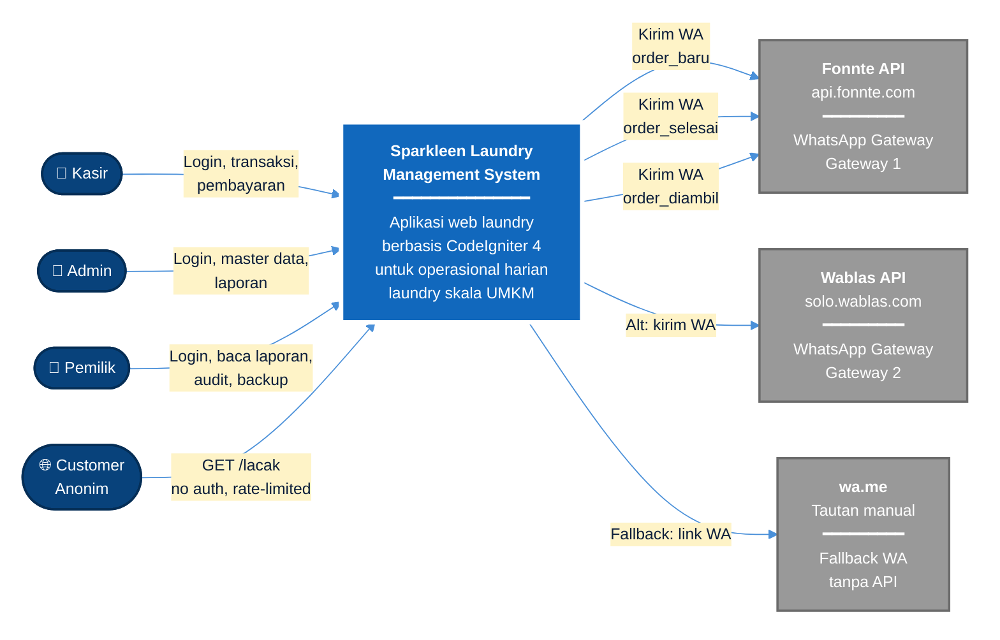

---

## 0B. HIGH-LEVEL: CONTAINER (C4 Level 2)

Arsitektur container: proses/artefak teknologi di dalam sistem.

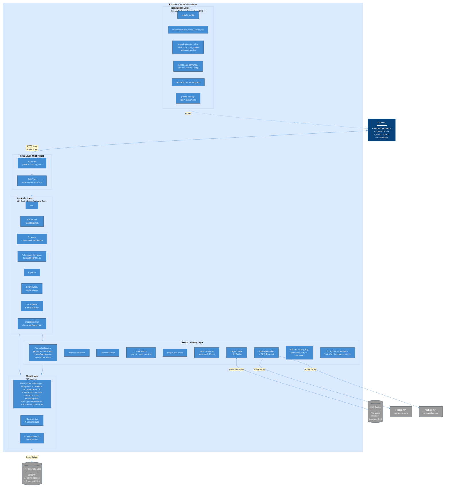

---

## 1. USE CASE DIAGRAM

```mermaid
%%{init: {'theme': 'base', 'themeVariables': {'primaryColor': '#e8f0fe', 'primaryBorderColor': '#1e3a5f', 'primaryTextColor': '#0b1d3a', 'lineColor': '#4a90d9', 'fontSize': '14px'}, 'flowchart': {'curve': 'basis', 'useMaxWidth': true, 'htmlLabels': true}}}%%
flowchart TB
    %% === Aktor (top row) ===
    subgraph AKTORS["Aktor (Pengguna Sistem)"]
        direction LR
        K([👤 Kasir])
        A([👤 Admin])
        P([👑 Pemilik])
        C([🌐 Publik<br/>Pelanggan])
    end

    %% === Sistem boundary ===
    subgraph SYS["<b>Sistem Sparkleen Laundry</b>"]
        direction TB

        %% --- Autentikasi ---
        subgraph AUTH["🔐 Autentikasi"]
            direction LR
            UC01(["Login"])
            UC02(["Logout"])
        end

        %% --- Dashboard ---
        subgraph DASH["📊 Dashboard"]
            direction TB
            UC03(["Kasir"])
            UC04(["Admin"])
            UC05(["Pemilik"])
            UC06(["Live Counter"])
        end

        %% --- Transaksi POS ---
        subgraph TRX["💳 Transaksi POS"]
            direction TB
            UC10(["Buat Transaksi"])
            UC11(["Cart"])
            UC12(["Simpan + PIN"])
            UC13(["Cetak Nota"])
            UC14(["Ubah Status"])
            UC15(["Pembayaran"])
            UC16(["Daftar Transaksi"])
            UC17(["Quick View"])
            UC18(["Kirim Ulang WA"])
        end

        %% --- Master Data ---
        subgraph MASTER["⚙️ Master Data"]
            direction TB
            UC20(["Pelanggan"])
            UC21(["Karyawan"])
            UC22(["Layanan"])
            UC23(["Inventaris"])
            UC24(["Resep"])
        end

        %% --- Laporan ---
        subgraph REPORT["📊 Laporan & Log"]
            direction TB
            UC30(["Laporan Transaksi"])
            UC31(["Export PDF/XLSX"])
            UC32(["Log Aktivitas"])
            UC33(["Log WhatsApp"])
        end

        %% --- Sistem ---
        subgraph SYSCORE["🛠️ Sistem"]
            direction TB
            UC40(["Backup DB"])
            UC41(["Profile & Password"])
            UC42(["Toggle Aktif"])
        end

        %% --- Publik ---
        subgraph PUB["🌐 Akses Publik"]
            direction LR
            UC50(["Lacak by Nota"])
            UC51(["Lacak by No HP"])
        end
    end

    %% === Asosiasi Actor → Use Case (dari aktor ke UC) ===
    K --> UC01 & UC02
    A --> UC01 & UC02
    P --> UC01 & UC02

    K --> UC03
    A --> UC04
    P --> UC05
    K -.->|AJAX poll| UC06

    K --> UC10 & UC11 & UC12 & UC13 & UC14 & UC15 & UC16 & UC17 & UC18

    A --> UC20 & UC21 & UC22 & UC23 & UC24

    A --> UC30 & UC31
    P --> UC30 & UC31 & UC32
    A --> UC33
    K --> UC33
    P --> UC33

    P --> UC40
    A --> UC41
    K --> UC41
    P --> UC41
    A --> UC42
    P --> UC42

    C --> UC50 & UC51

    classDef actor fill:#1e3a5f,color:#fff,stroke:#0b1d3a,stroke-width:2px
    classDef uc fill:#e8f0fe,color:#0b1d3a,stroke:#4a90d9,stroke-width:1px
    classDef pubUC fill:#cffafe,color:#0e7490,stroke:#0891b2,stroke-width:1px

    class K,A,P,C actor
    class UC01,UC02,UC03,UC04,UC05,UC06,UC10,UC11,UC12,UC13,UC14,UC15,UC16,UC17,UC18,UC20,UC21,UC22,UC23,UC24,UC30,UC31,UC32,UC33,UC40,UC41,UC42 uc
    class UC50,UC51 pubUC
```

---

## 2. SEQUENCE DIAGRAM: LOGIN

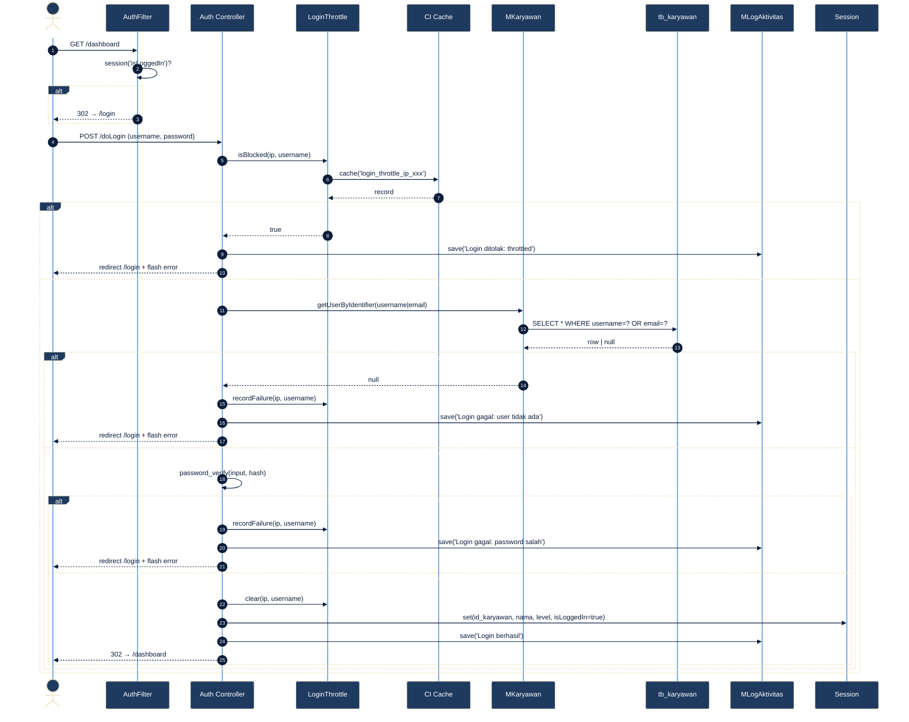

---

## 3. SEQUENCE DIAGRAM: BUAT TRANSAKSI (3-STEP WIZARD)

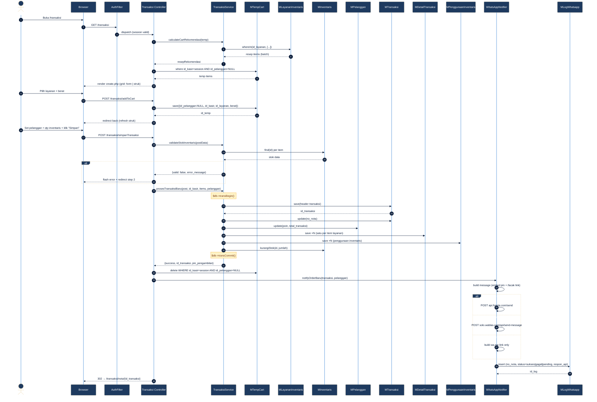

---

## 4. SEQUENCE DIAGRAM: PEMBAYARAN (CICILAN/LUNAS)

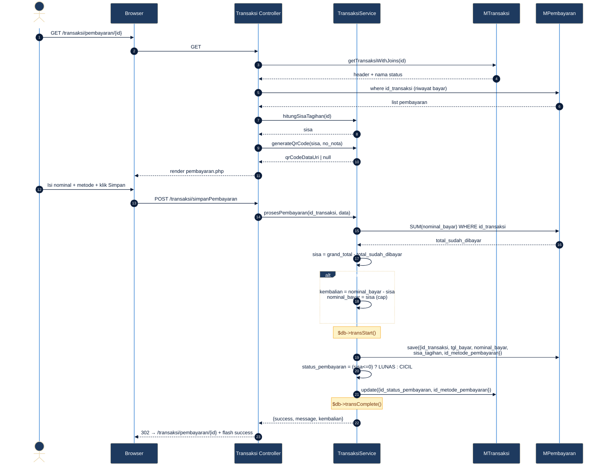

---

## 5. SEQUENCE DIAGRAM: LACAK ORDER PUBLIK

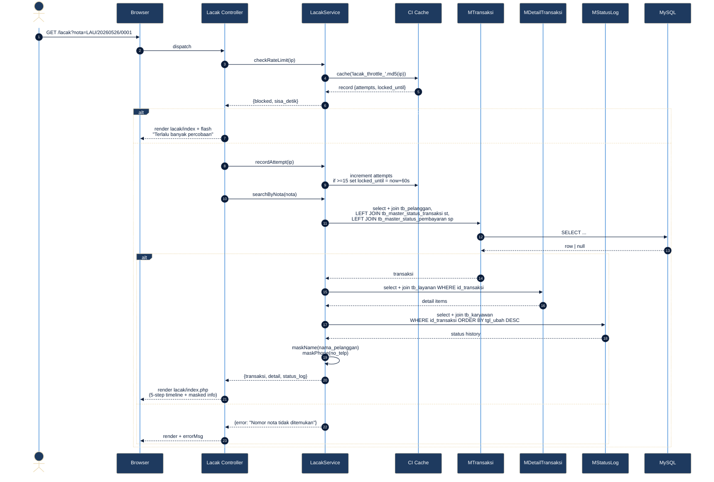

---

## 6. ACTIVITY DIAGRAM: LOGIN

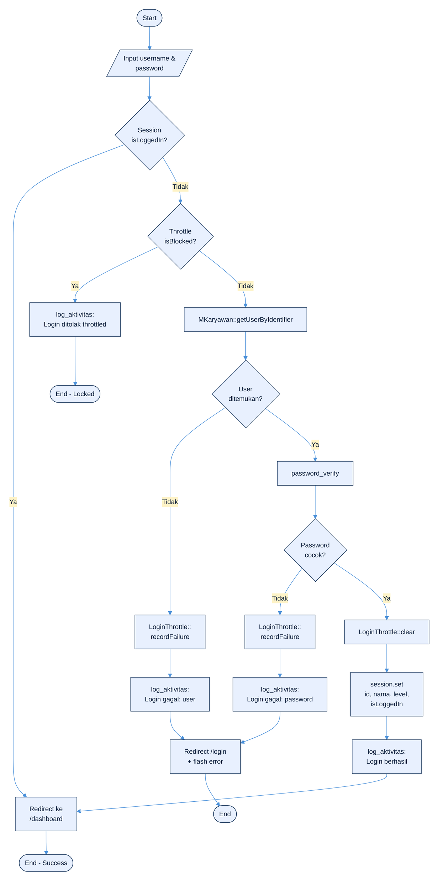

---

## 7. ACTIVITY DIAGRAM: BUAT TRANSAKSI

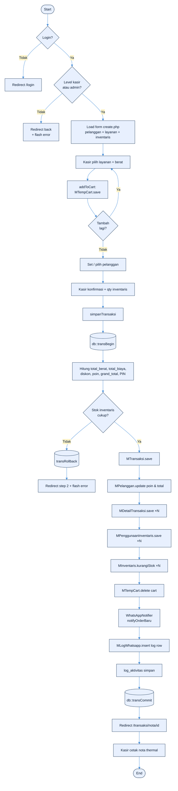

---

## 8. ACTIVITY DIAGRAM: UBAH STATUS TRANSAKSI

```mermaid
%%{init: {'theme': 'base', 'themeVariables': {'primaryColor': '#e8f0fe', 'primaryBorderColor': '#1e3a5f', 'primaryTextColor': '#0b1d3a', 'lineColor': '#4a90d9', 'secondaryColor': '#fef3c7', 'tertiaryColor': '#dbeafe', 'fontSize': '14px'}, 'flowchart': {'curve': 'basis', 'useMaxWidth': true, 'htmlLabels': true, 'diagramPadding': 20}}}%%
flowchart TD
    START([Start]) --> OPEN_FORM[Transaksi::ubahStatus id]
    OPEN_FORM --> LOAD[Load transaksi + master status +<br/>TransaksiService::checkPinRequired]
    LOAD --> RENDER[Render ubah_status.php]
    RENDER --> PILIH[Kasir pilih status_baru +<br/>opsional kirim_wa]
    PILIH --> SUBMIT[POST /transaksi/prosesUbahStatus]
    SUBMIT --> SVC[TransaksiService::prosesUbahStatus]
    SVC --> UPDATE[MTransaksi.update status]
    UPDATE --> LOG_STATUS[MStatusLog.save]
    LOG_STATUS --> CEK_SELESAI{status_baru ==<br/>'selesai'?}
    CEK_SELESAI -- Ya --> SET_AKTUAL[MTransaksi.update<br/>tgl_selesai_aktual]
    SET_AKTUAL --> KIRIM_WA1{kirim_wa<br/>== 1?}
    KIRIM_WA1 -- Ya --> WA_SELESAI[WhatsAppNotifier<br/>notifyOrderSelesai]
    KIRIM_WA1 -- Tidak --> CEK_AMBIL
    WA_SELESAI --> WLOG1[MLogWhatsapp.insert]
    WLOG1 --> CEK_AMBIL{status_baru ==<br/>'diambil'?}
    CEK_SELESAI -- Tidak --> CEK_AMBIL
    CEK_AMBIL -- Ya --> KIRIM_WA2{kirim_wa<br/>== 1?}
    KIRIM_WA2 -- Ya --> WA_AMBIL[WhatsAppNotifier<br/>notifyOrderDiambil]
    KIRIM_WA2 -- Tidak --> SVC_RET
    WA_AMBIL --> WLOG2[MLogWhatsapp.insert]
    WLOG2 --> SVC_RET
    CEK_AMBIL -- Tidak --> SVC_RET
    SVC_RET["SVC returns: success, message, wa_result"]
    SVC_RET --> REDIR_DET[Redirect /transaksi/detail/id]
    REDIR_DET --> END([End])
```

---

## 9. FLOWCHART: SISTEM (MASTER)

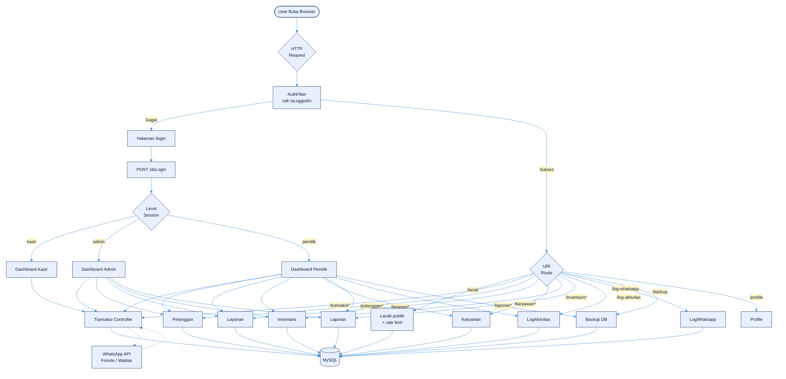

---

## 10. FLOWCHART: TRANSAKSI POS

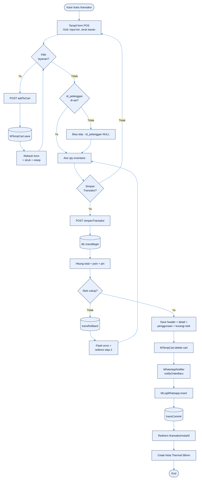

---

## 11. BPMN: PROSES ORDER LAUNDRY (END-TO-END)

```mermaid
%%{init: {'theme': 'base', 'themeVariables': {'primaryColor': '#e8f0fe', 'primaryBorderColor': '#1e3a5f', 'primaryTextColor': '#0b1d3a', 'lineColor': '#4a90d9', 'secondaryColor': '#fef3c7', 'tertiaryColor': '#dbeafe', 'fontSize': '14px'}, 'flowchart': {'curve': 'basis', 'useMaxWidth': true, 'htmlLabels': true, 'diagramPadding': 20}}}%%
flowchart LR
    %% Pool 1: Customer
    subgraph POOL_C["🏊 Pool: Customer"]
        C1([Start: Bawa cucian]) --> C2[Datang ke outlet]
        C2 --> C2a{Bawa<br/>struk lama?}
        C2a -- Ya --> C2b[Tunjukkan<br/>nomor nota]
        C2a -- Tidak --> C2c[Setor cucian<br/>baru]
        C2c --> C2d[Pesan layanan]
    end

    C2b --> P1
    C2d --> P1

    %% Pool 2: Kasir
    subgraph POOL_K["🏊 Pool: Kasir Sparkleen"]
        P1[Terima cucian] --> P2{Cek<br/>pelanggan?}
        P2 -- Baru --> P3[Buat entry<br/>pelanggan]
        P2 -- Lama --> P4[Pilih dari list]
        P3 --> P5
        P4 --> P5
        P5[Pilih layanan + berat] --> P6[Tambah ke cart]
        P6 --> P7{Stok<br/>bahan baku<br/>cukup?}
        P7 -- Tidak --> P8[Tolak sebagian<br/>atau info delay]
        P7 -- Ya --> P9[Generate PIN<br/>+ Nota]
        P9 --> P10[Simpan ke DB]
        P10 --> P11[Kirim WA<br/>order baru]
        P11 --> P12((Parallel:))
        P12 --> P12a[Cuci]
        P12a --> P12b[Setrika]
        P12b --> P13{Selesai?}
        P13 -- Ya --> P14[Update status<br/>'selesai']
        P14 --> P15[Kirim WA<br/>order selesai]
        P15 --> P16[Cucian siap<br/>diambil]
        P16 --> P17{Pelanggan<br/>datang?}
        P17 -- Ya --> P18[Verifikasi PIN]
        P18 --> P19{Pin valid?}
        P19 -- Tidak --> P20[Tolak<br/>pengambilan]
        P19 -- Ya --> P21[Serahkan cucian]
        P21 --> P22[Update status<br/>'diambil']
        P22 --> P23[Kirim WA<br/>order diambil]
        P23 --> P24([End])
        P17 -- Belum --> P16
    end

    %% Pool 3: Admin/Pemilik
    subgraph POOL_A["🏊 Pool: Admin / Pemilik"]
        P10 -.->|notif| M1[Monitor dashboard]
        M1 --> M2[Lihat laporan<br/>harian/bulanan]
        M2 --> M3[Export PDF/Excel]
        M3 --> M4([End: Reporting])
    end

    %% Styling hint
    classDef startEnd fill:#ffd966,stroke:#333,stroke-width:2px
    classDef task fill:#9bc2e6,stroke:#333
    classDef gateway fill:#f4b183,stroke:#333
    class C1,C24,P24,M4 startEnd
    classDef poolC fill:#d9ead3,stroke:#38761d
    classDef poolK fill:#cfe2f3,stroke:#1c4587
    classDef poolA fill:#fff2cc,stroke:#7f6000
    class POOL_C poolC
    class POOL_K poolK
    class POOL_A poolA
```

---

## 12. ERD (ENTITY-RELATIONSHIP DIAGRAM)

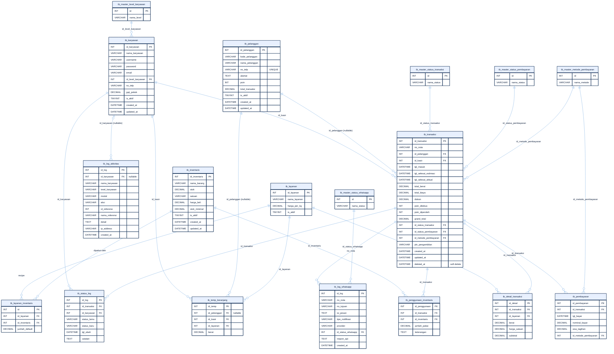

---

## 13. LRS (LOGICAL RECORD STRUCTURE)

Notasi LRS: record = kotak, primary key = garis bawah, foreign key = panah. Junction table = kotak dengan 2 FK keluar.

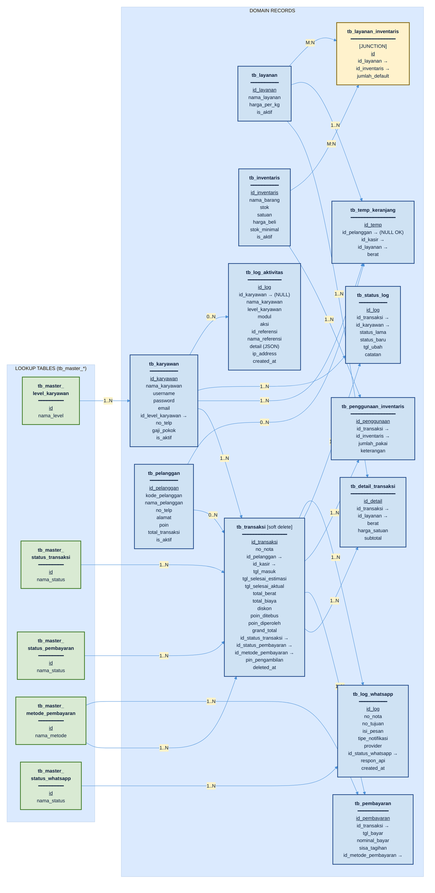

---

## Catatan Render

- **Mermaid versi minimum:** 10.x (untuk `flowchart` dengan styling class & `erDiagram` dengan atribut).
- **CDN default:** `https://cdn.jsdelivr.net/npm/mermaid@10/dist/mermaid.min.js`
- **Untuk export:** gunakan [mermaid.live](https://mermaid.live) atau CLI `mmdc -i file.md -o output.png`.
- **Update berikutnya** jika ada perubahan arsitektur: edit file ini + buka `mermaid_renderer.html` untuk live preview.
