# UML & System Design Documentation: Sparkleen Laundry App

Dokumentasi ini menyajikan rancangan arsitektur, aliran logika, dan struktur data sistem **Sparkleen Laundry App** menggunakan standar Unified Modeling Language (UML) dan representasi visual pendukung lainnya.

---

## 1. Use Case Diagram

Diagram Use Case mendefinisikan batas sistem, fungsionalitas utama, dan hak akses dari masing-masing aktor (Kasir, Admin, Pemilik, dan Pelanggan Publik).

```mermaid
graph TD
    subgraph Aktor
        Pelanggan((Pelanggan Publik))
        Kasir((Kasir))
        Admin((Admin))
        Pemilik((Pemilik))
    end

    subgraph "Sistem Sparkleen Laundry (Use Cases)"
        UC_Login([Melakukan Login])
        UC_Profil([Kelola Profil & Ganti Password])
        UC_Transaksi([Kelola Transaksi & Detail])
        UC_LiveSearch([Pencarian Data Live / Filter])
        UC_CariPelanggan([Cari Data Pelanggan])
        UC_Pelanggan([Kelola Data Pelanggan])
        UC_Bayar([Kelola Pembayaran & Cicilan])
        UC_InventarisPakai([Catat Penggunaan Inventaris])
        UC_WA([Kirim Notifikasi WA])
        UC_UbahStatus([Ubah Status Laundry])
        UC_Karyawan([Kelola Data Karyawan])
        UC_Layanan([Kelola Data Layanan])
        UC_ResepLayanan([Kelola Resep Bahan Baku])
        UC_Inventaris([Kelola Stok & Inventaris])
        UC_Laporan([Lihat & Cetak Laporan Keuangan])
        UC_LogAktivitas([Lihat/Monitor Log Aktivitas])
        UC_LogWhatsapp([Lihat Log WhatsApp])
        UC_Backup([Backup Database])
        UC_LacakOrder([Lacak Status Order])
    end

    Pelanggan --> UC_LacakOrder

    Kasir --> UC_Login
    Kasir --> UC_Profil
    Kasir --> UC_Transaksi
    Kasir --> UC_UbahStatus
    Kasir --> UC_Pelanggan
    Kasir --> UC_Bayar
    Kasir --> UC_LogWhatsapp
    Kasir -.->|view only| UC_Inventaris

    Admin --> UC_Login
    Admin --> UC_Profil
    Admin --> UC_Karyawan
    Admin --> UC_Layanan
    Admin --> UC_ResepLayanan
    Admin --> UC_Inventaris
    Admin --> UC_Transaksi
    Admin --> UC_UbahStatus
    Admin --> UC_Pelanggan
    Admin --> UC_Bayar
    Admin --> UC_Laporan
    Admin --> UC_LogWhatsapp
    Admin --> UC_Backup

    Pemilik --> UC_Login
    Pemilik --> UC_Profil
    Pemilik --> UC_Karyawan
    Pemilik --> UC_Layanan
    Pemilik --> UC_Inventaris
    Pemilik --> UC_Laporan
    Pemilik --> UC_LogAktivitas
    Pemilik --> UC_LogWhatsapp
    Pemilik --> UC_Backup
    Pemilik -.->|view only| UC_Transaksi
    Pemilik -.->|view & toggle| UC_Pelanggan

    %% Hubungan Include & Extend
    UC_Transaksi -.->|include| UC_CariPelanggan
    UC_Pelanggan -.->|extend| UC_CariPelanggan
    UC_Pelanggan -.->|include| UC_LiveSearch
    UC_Karyawan -.->|include| UC_LiveSearch
    UC_Layanan -.->|include| UC_LiveSearch
    UC_Inventaris -.->|include| UC_LiveSearch
    UC_Transaksi -.->|include| UC_LiveSearch
    UC_InventarisPakai -.->|extend| UC_Transaksi
    UC_Transaksi -.->|include| UC_WA
    UC_UbahStatus -.->|include| UC_WA
    UC_Bayar -.->|include| UC_Transaksi
    UC_ResepLayanan -.->|extend| UC_Layanan
```

---

## 2. Activity Diagram

Bagian ini memodelkan aliran aktivitas bisnis utama yang berjalan di dalam sistem.

### A. Proses Transaksi Laundry
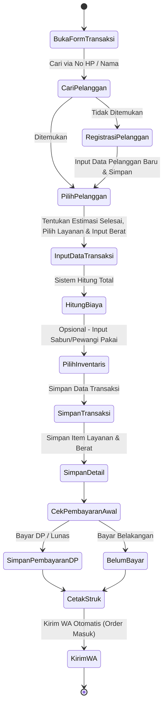

### B. Update Status Laundry
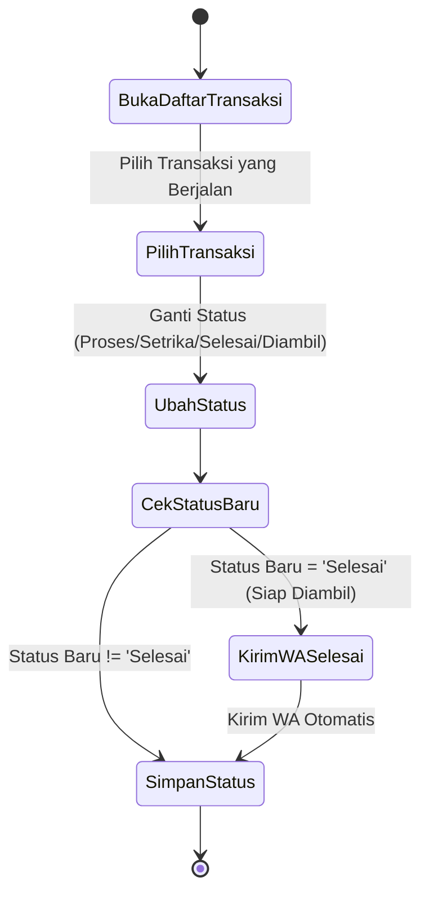

### C. Pembayaran (Pelunasan)
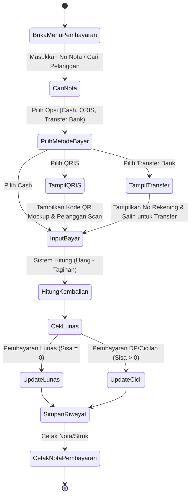

---

## 3. Sequence Diagram

Bagian ini memodelkan interaksi pertukaran pesan (message-passing) antarkomponen perangkat lunak saat mengeksekusi skenario sistem.

### A. Proses Transaksi Laundry
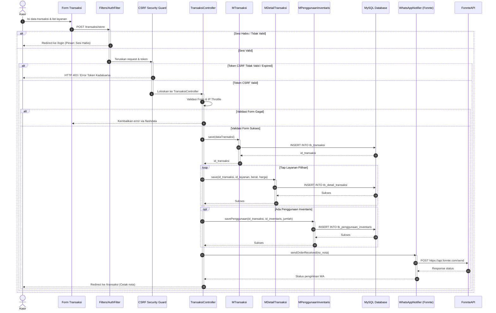

### B. Proses Pembayaran Cicilan
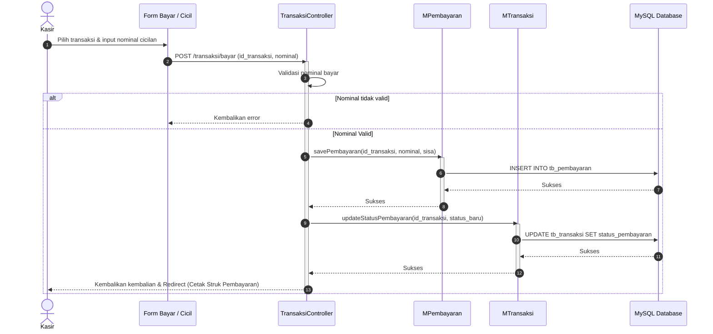

### C. Proses Quick View Modal Transaksi (AJAX)
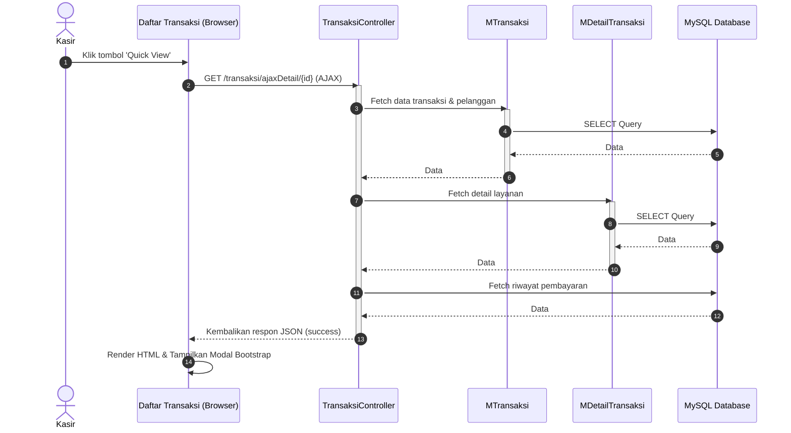

### D. Proses Pencarian Data Live (AJAX Live Search)
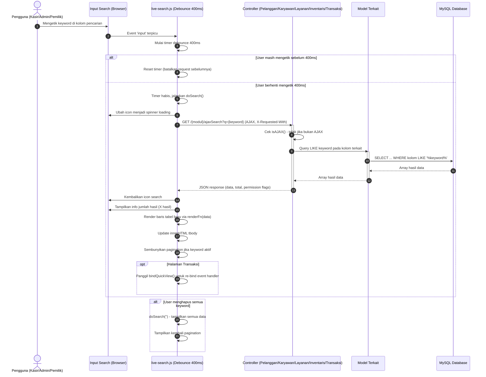

---

## 4. Class Diagram

Class diagram menggambarkan arsitektur berbasis objek (OOP) di sisi Controller dan Model (CodeIgniter 4) beserta hubungannya.

```mermaid
classDiagram
    class BaseController {
        #request: RequestInterface
        #response: ResponseInterface
        #logger: LoggerInterface
        +initController()
    }

    class Auth {
        -loginThrottle: LoginThrottle
        +login()
        +doLogin()
        +logout()
    }

    class Dashboard {
        -transaksiModel: MTransaksi
        -inventarisModel: MInventaris
        +index()
        +getChart7Hari()
        +getCucianJatuhTempo()
    }

    class Transaksi {
        -transaksiModel: MTransaksi
        -pelangganModel: MPelanggan
        -layananModel: MLayanan
        -detailModel: MDetailTransaksi
        -tempModel: MTempPeminjaman
        -inventarisModel: MInventaris
        -penggunaanModel: MPenggunaanInventaris
        -layananInventarisModel: MLayananInventaris
        +index()
        +addToCart()
        +removeFromCart()
        +simpanTransaksi()
        +nota()
        +daftar()
        +detail()
        +ajaxDetail()
        +ajaxSearch()
        +ubahStatus()
        +prosesUbahStatus()
        +pembayaran()
        +simpanPembayaran()
        +kirimWaApi()
    }

    class Pelanggan {
        -pelangganModel: MPelanggan
        +index()
        +create()
        +store()
        +edit()
        +update()
        +toggleStatus()
        +ajaxSearch()
        +ajaxSearchTable()
    }

    class Karyawan {
        -karyawanModel: MKaryawan
        +index()
        +create()
        +store()
        +edit()
        +update()
        +delete()
        +toggleStatus()
        +ajaxSearch()
    }

    class Layanan {
        -layananModel: MLayanan
        -inventarisModel: MInventaris
        -layananInventarisModel: MLayananInventaris
        +index()
        +create()
        +store()
        +edit()
        +update()
        +toggleStatus()
        +resep()
        +resepStore()
        +ajaxSearch()
    }

    class Inventaris {
        -inventarisModel: MInventaris
        +index()
        +create()
        +store()
        +edit()
        +update()
        +toggleStatus()
        +warning()
        +ajaxSearch()
    }

    class Laporan {
        -transaksiModel: MTransaksi
        +index()
        +harian()
        +bulanan()
        +export_harian_pdf()
        +export_bulanan_pdf()
        +export_harian_excel()
        +export_bulanan_excel()
    }

    class Profile {
        -karyawanModel: MKaryawan
        +index()
        +update()
    }

    class LogAktivitas {
        -logModel: MLogAktivitas
        +index()
    }

    class LogWhatsapp {
        -logModel: MLogWhatsapp
        +index()
    }

    class Lacak {
        -transaksiModel: MTransaksi
        -detailModel: MDetailTransaksi
        +index()
    }

    class Backup {
        -level: string
        +index()
        +download()
    }

    class AuthFilter {
        +before()
        +after()
    }

    class LoginThrottle {
        -session: Session
        +checkThrottle()
        +incrementFailure()
        +resetThrottle()
    }

    class activity_log_helper {
        +log_aktivitas()
        +detail_perubahan()
        +badge_level_karyawan()
    }

    class WhatsAppNotifier {
        +apiToken: string
        +provider: string
        +notifyOrderBaru(array transaksi, array pelanggan)
        +notifyOrderSelesai(array transaksi, array pelanggan)
        +notifyOrderDiambil(array transaksi, array pelanggan)
        +normalizePhone()
        +buildWaMeLink()
        -sendRequest()
    }

    class MTransaksi {
        +table: string = tb_transaksi
        +primaryKey: string = id_transaksi
        +allowedFields: array
        +getTransaksiWithDetail()
        +getLaporanBulanan()
    }

    class MPelanggan {
        +table: string = tb_pelanggan
        +primaryKey: string = id_pelanggan
        +allowedFields: array
        +generateKode()
    }

    class MKaryawan {
        +table: string = tb_karyawan
        +primaryKey: string = id_karyawan
        +allowedFields: array
        +verifyLogin()
    }

    class MLayanan {
        +table: string = tb_layanan
        +primaryKey: string = id_layanan
        +allowedFields: array
    }

    class MInventaris {
        +table: string = tb_inventaris
        +primaryKey: string = id_inventaris
        +allowedFields: array
        +getStokKritis()
    }

    class MLayananInventaris {
        +table: string = tb_layanan_inventaris
        +primaryKey: string = id_layanan_inventaris
        +allowedFields: array
    }

    class MLogAktivitas {
        +table: string = tb_log_aktivitas
        +primaryKey: string = id_log
        +logAksi()
    }

    class MLogWhatsapp {
        +table: string = tb_log_whatsapp
        +primaryKey: string = id_log
        +allowedFields: array
        +getDaftarLog()
    }

    BaseController <|-- Auth
    BaseController <|-- Dashboard
    BaseController <|-- Transaksi
    BaseController <|-- Pelanggan
    BaseController <|-- Karyawan
    BaseController <|-- Layanan
    BaseController <|-- Inventaris
    BaseController <|-- Laporan
    BaseController <|-- Profile
    BaseController <|-- LogAktivitas
    BaseController <|-- LogWhatsapp
    BaseController <|-- Lacak
    BaseController <|-- Backup

    Auth ..> LoginThrottle : Menggunakan
    AuthFilter ..> BaseController : Mengamankan Akses Rute
    Dashboard ..> MTransaksi : Memakai
    Dashboard ..> MInventaris : Memakai
    Transaksi ..> MTransaksi : Memakai
    Transaksi ..> MPelanggan : Memakai
    Transaksi ..> MLayanan : Memakai
    Transaksi ..> MInventaris : Memakai
    Transaksi ..> MLayananInventaris : Memakai
    Transaksi ..> WhatsAppNotifier : Menggunakan
    Pelanggan ..> MPelanggan : Memakai
    Karyawan ..> MKaryawan : Memakai
    Karyawan ..> activity_log_helper : Mencatat Aksi
    Layanan ..> MLayanan : Memakai
    Layanan ..> MInventaris : Memakai
    Layanan ..> MLayananInventaris : Memakai
    Inventaris ..> MInventaris : Memakai
    Inventaris ..> activity_log_helper : Mencatat Aksi
    Laporan ..> MTransaksi : Memakai
    Profile ..> MKaryawan : Memakai
    LogAktivitas ..> MLogAktivitas : Memakai
    LogWhatsapp ..> MLogWhatsapp : Memakai
    Lacak ..> MTransaksi : Memakai
    Backup ..> MLogAktivitas : Mencatat Log Keamanan
    activity_log_helper ..> MLogAktivitas : Menyimpan ke
```

---

## 5. Entity Relationship Diagram (ERD)

ERD menggambarkan struktur logis basis data relasional Sparkleen Laundry secara detail beserta relasi antar-entitas.

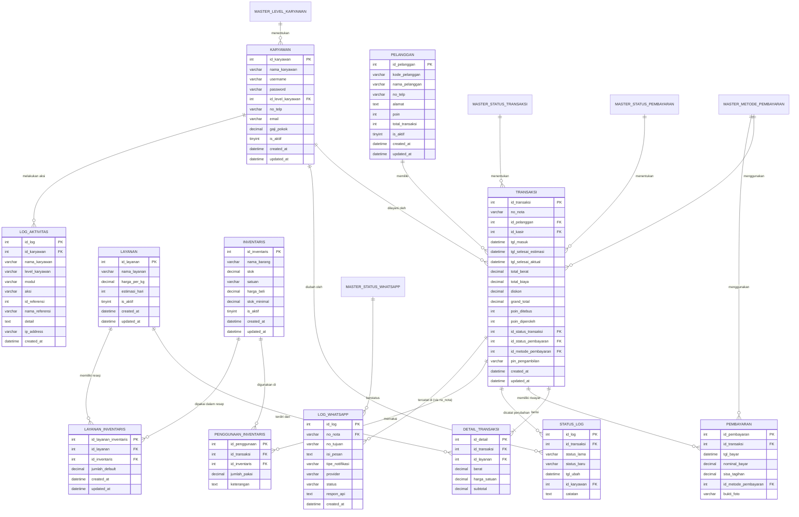

---

## 6. Logical Record Structure (LRS)

LRS menyajikan hubungan antar tabel database yang dinormalisasi dengan memperlihatkan Cardinality, Primary Key (PK), dan Foreign Key (FK).

Berikut adalah representasi visual LRS menggunakan diagram relasi fisik:

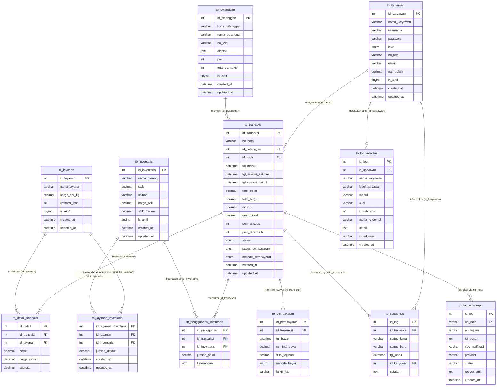

Berikut adalah representasi LRS secara tekstual terstruktur:

```text
tb_karyawan (
   id_karyawan: INT (PK)
   nama_karyawan: VARCHAR(100)
   username: VARCHAR(50)
   password: VARCHAR(255)
   level: ENUM('admin', 'kasir', 'pemilik')
   no_telp: VARCHAR(15)
   email: VARCHAR(100)
   gaji_pokok: DECIMAL(10,2)
   is_aktif: TINYINT(1)
   created_at: DATETIME
   updated_at: DATETIME
)
   |
   |-- dilayani (1:N) --------------------------------+
   |-- mencatat aksi (1:N) -----+                     |
   |                            |                     |
tb_log_aktivitas (              |                     |
   id_log: INT (PK)             |                     |
   id_karyawan: INT (FK) -------+                     |
   nama_karyawan: VARCHAR(100)                        |
   level_karyawan: VARCHAR(20)                        |
   modul: VARCHAR(50)                                 |
   aksi: VARCHAR(50)                                  |
   id_referensi: INT                                  |
   nama_referensi: VARCHAR(150)                       |
   detail: TEXT                                       |
   ip_address: VARCHAR(45)                            |
   created_at: DATETIME                               |
)                                                     |
                                                      |
tb_pelanggan (                                        |
   id_pelanggan: INT (PK)                             |
   kode_pelanggan: VARCHAR(20)                        |
   nama_pelanggan: VARCHAR(100)                       |
   no_telp: VARCHAR(15)                               |
   alamat: TEXT                                       |
   poin: INT                                          |
   total_transaksi: INT                               |
   is_aktif: TINYINT(1)                               |
   created_at: DATETIME                               |
   updated_at: DATETIME                               |
)                                                     |
   |                                                  |
   |-- memiliki (1:N) --------+                       |
                              |                       |
                           tb_transaksi (             |
                              id_transaksi: INT (PK)  |
                              no_nota: VARCHAR(20)    |
                              id_pelanggan: INT (FK) -+
                              id_kasir: INT (FK) <----+
                              tgl_masuk: DATETIME
                              tgl_selesai_estimasi: DATETIME
                              tgl_selesai_aktual: DATETIME
                              total_berat: DECIMAL(10,2)
                              total_biaya: DECIMAL(10,2)
                              diskon: DECIMAL(10,2)
                              grand_total: DECIMAL(10,2)
                              poin_ditebus: INT
                              poin_diperoleh: INT
                              status: ENUM('menunggu', 'proses', 'setrika', 'selesai', 'diambil')
                              status_pembayaran: ENUM('lunas', 'cicil', 'belum')
                              metode_pembayaran: ENUM('cash', 'qris', 'transfer')
                              created_at: DATETIME
                              updated_at: DATETIME
                           )
                              |
                              |-- memiliki riwayat (1:N) ---> tb_pembayaran (
                              |                                  id_pembayaran: INT (PK)
                              |                                  id_transaksi: INT (FK)
                              |                                  tgl_bayar: DATETIME
                              |                                  nominal_bayar: DECIMAL(10,2)
                              |                                  sisa_tagihan: DECIMAL(10,2)
                              |                                  metode_bayar: ENUM('cash', 'qris', 'transfer')
                              |                               )
                              |
                              |-- dicatat riwayat (1:N) ----> tb_status_log (
                              |                                  id_log: INT (PK)
                              |                                  id_transaksi: INT (FK)
                              |                                  status_lama: VARCHAR(20)
                              |                                  status_baru: VARCHAR(20)
                              |                                  tgl_ubah: DATETIME
                              |                                  id_karyawan: INT (FK)
                              |                                  catatan: TEXT
                              |                               )
                              |
                              |-- berisi item (1:N) --------> tb_detail_transaksi (
                              |                                  id_detail: INT (PK)
                              |                                  id_transaksi: INT (FK)
                              |                                  id_layanan: INT (FK) ---+
                              |                                  berat: DECIMAL(10,2)    |
                              |                                  harga_satuan: DECIMAL(10,2)
                              |                                  subtotal: DECIMAL(10,2) |
                              |                               )                        |
                              |
                              |-- tercatat WA (1:N) --------> tb_log_whatsapp (
                                                                 id_log: INT (PK)
                                                                 no_nota: VARCHAR(20) (FK)
                                                                 no_tujuan: VARCHAR(20)
                                                                 isi_pesan: TEXT
                                                                 tipe_notifikasi: VARCHAR(50)
                                                                 provider: VARCHAR(50)
                                                                 status: VARCHAR(20)
                                                                 respon_api: TEXT
                                                                 created_at: DATETIME
                                                              )
                              |                                                        |
                              |                               tb_layanan (             |
                              |                                  id_layanan: INT (PK) <+
                              |                                  nama_layanan: VARCHAR(50)
                              |                                  harga_per_kg: DECIMAL(10,2)
                              |                                  estimasi_hari: INT(3)
                              |                                  is_aktif: TINYINT(1)
                              |                               )
                              |                                  |
                              |                                  |-- memiliki resep (1:N) --> tb_layanan_inventaris (
                              |                                                                  id_layanan_inventaris: INT (PK)
                              |                                                                  id_layanan: INT (FK)
                              |                                                                  id_inventaris: INT (FK) --+
                              |                                                                  jumlah_default: DECIMAL(10,4)
                              |                                                                  created_at: DATETIME      |
                              |                                                                  updated_at: DATETIME      |
                              |                                                               )                           |
                              |                                                                                            |
                              |-- digunakan (1:N) ----------> tb_penggunaan_inventaris (                                   |
                                                                 id_penggunaan: INT (PK)                                   |
                                                                 id_transaksi: INT (FK)                                    |
                                                                 id_inventaris: INT (FK) --+                               |
                                                                 jumlah_pakai: DECIMAL(10,2)                               |
                                                                 keterangan: TEXT          |                               |
                                                              )                            |                               |
                                                                                           |                               |
                                                              tb_inventaris (              |                               |
                                                                 id_inventaris: INT (PK) <-+<-----------------------------+
                                                                 nama_barang: VARCHAR(100)
                                                                 stok: DECIMAL(10,2)
                                                                 satuan: VARCHAR(20)
                                                                 harga_beli: DECIMAL(10,2)
                                                                 stok_minimal: DECIMAL(10,2)
                                                                 is_aktif: TINYINT(1)
                                                              )
```

---

## 7. Deployment Diagram

Deployment diagram menggambarkan bagaimana komponen perangkat lunak didistribusikan ke atas infrastruktur fisik jaringan.

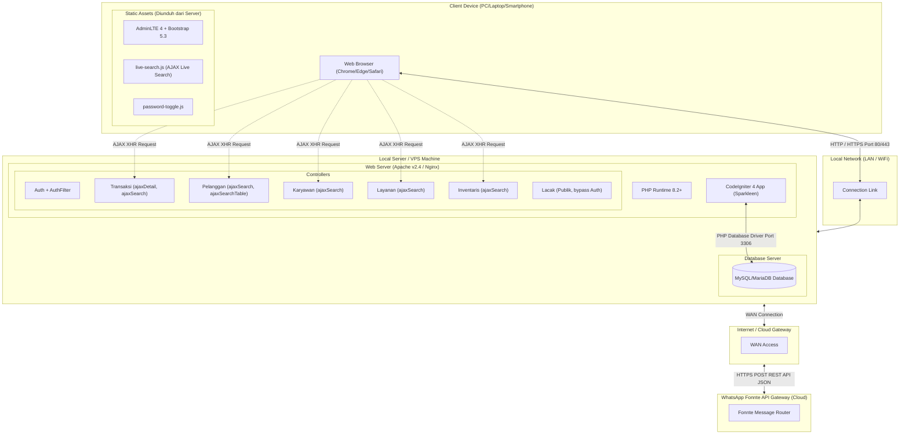

---

## 8. Flowchart Sistem

Berikut adalah bagan alir logika untuk modul internal yang membutuhkan kontrol alur ketat.

### A. Proses Login
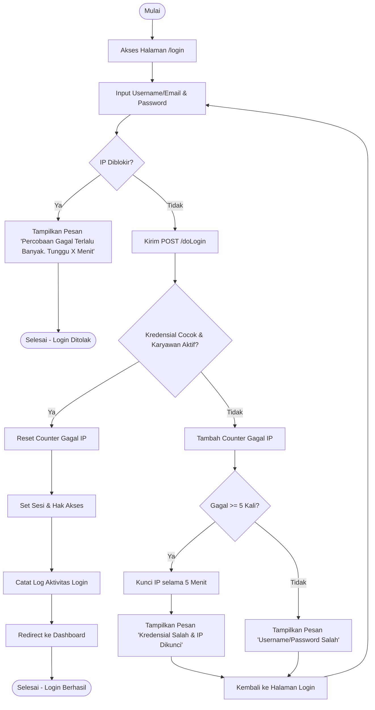

### B. Proses CRUD Pelanggan
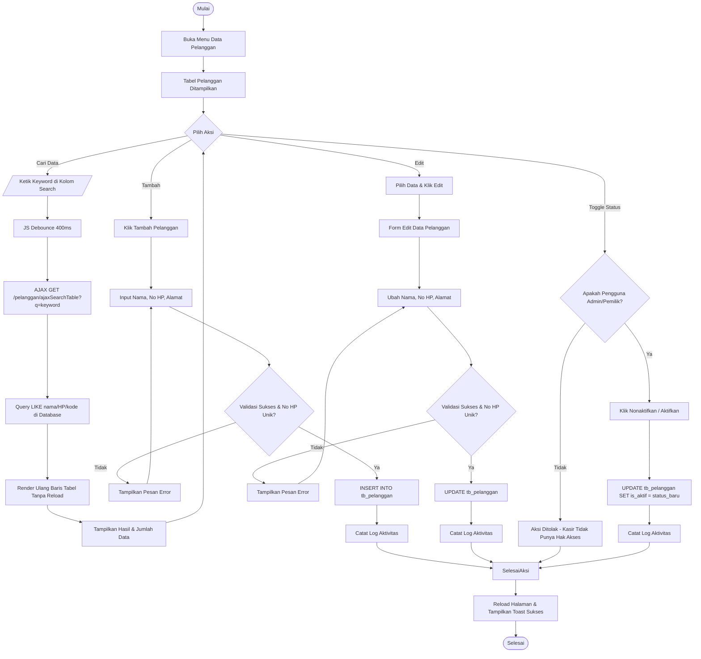

### C. Alur Utama Sistem (Overview)
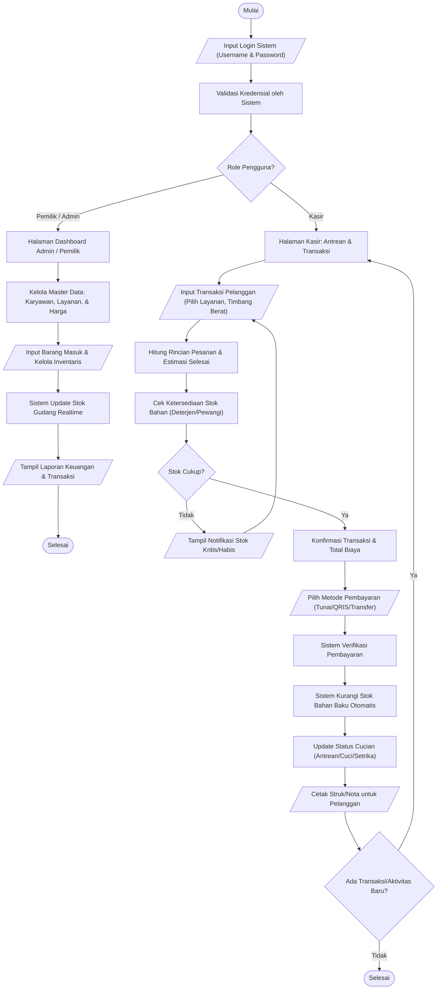

### D. Alur Transaksi Baru & Validasi Stok
```mermaid
flowchart TD
    Start([Mulai]) --> AksesFormTransaksi[Kasir Buka Form Transaksi Baru]
    AksesFormTransaksi --> InputPelanggan[Cari Pelanggan via Nama / No HP]
    InputPelanggan --> CekPelanggan{Apakah Pelanggan Terdaftar?}
    
    CekPelanggan -- Tidak --> RegistrasiPelanggan[Input Nama, No HP, Alamat Pelanggan Baru]
    RegistrasiPelanggan --> SimpanPelanggan[Simpan ke tb_pelanggan]
    SimpanPelanggan --> PilihPelanggan[Pilih Pelanggan Tersebut]
    CekPelanggan -- Ya --> PilihPelanggan
    
    PilihPelanggan --> PilihLayanan[Pilih Layanan & Input Berat]
    PilihLayanan --> HitungSubtotal[Sistem Hitung Subtotal Harga]
    HitungSubtotal --> PoinLoyalitas{Ingin Tebus Poin?}
    
    PoinLoyalitas -- Ya --> CekPoin{Poin Cukup & Poin Ditebus <= Tagihan?}
    PoinLoyalitas -- Tidak --> HitungGrandTotal[Sistem Hitung Grand Total & Poin Baru Diperoleh]
    
    CekPoin -- Tidak --> TampilkanPesanPoin[Tampilkan Peringatan Poin Tidak Valid]
    TampilkanPesanPoin --> PoinLoyalitas
    CekPoin -- Ya --> PotongDiskon[Hitung Potongan Diskon Poin & Terapkan]
    PotongDiskon --> HitungGrandTotal
    
    HitungGrandTotal --> LoadResepBahan[Sistem Load Resep Bahan Baku untuk Layanan]
    LoadResepBahan --> TampilkanPrefillInventaris[Tampilkan Prefill Penggunaan Inventaris]
    TampilkanPrefillInventaris --> ValidasiStok{Apakah Kebutuhan Stok <= Stok Tersedia?}
    
    ValidasiStok -- Tidak --> BlokirPenyimpanan[Tampilkan Pesan 'Stok Tidak Cukup' & Blokir Tombol Simpan]
    BlokirPenyimpanan --> PilihLayanan
    
    ValidasiStok -- Ya --> SimpanTransaksi[INSERT INTO tb_transaksi & tb_detail_transaksi]
    SimpanTransaksi --> PotongStokDatabase[UPDATE tb_inventaris: Potong Jumlah Stok]
    PotongStokDatabase --> CatatPenggunaanInventaris[INSERT INTO tb_penggunaan_inventaris]
    CatatPenggunaanInventaris --> CekPembayaran{Bayar DP / Lunas?}
    
    CekPembayaran -- Ya --> CatatPembayaran[INSERT INTO tb_pembayaran]
    CekPembayaran -- Tidak --> CetakStruk[Cetak Struk Transaksi Termal]
    
    CatatPembayaran --> CetakStruk
    CetakStruk --> KirimWANotif[Kirim WA Otomatis: Order Baru Diterima]
    KirimWANotif --> CatatLogAktivitas[Catat Log Aktivitas Transaksi]
    CatatLogAktivitas --> Selesai([Selesai])
```

### E. Alur Pelunasan & Pembayaran (DP/Cicil/Lunas)
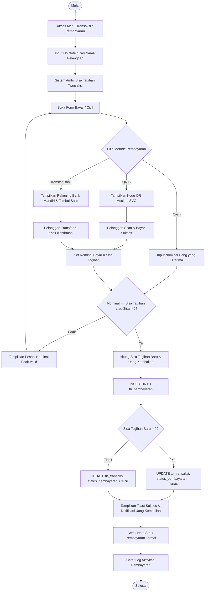

### F. Alur Pembuatan Laporan Keuangan
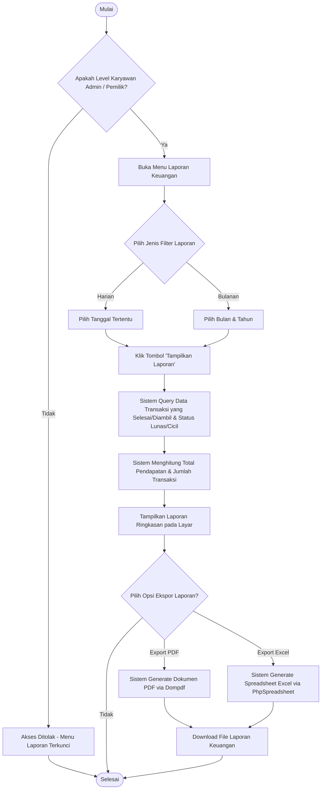

---

## 9. Business Process Model and Notation (BPMN)
Menggambarkan alur kerja utama bisnis dari pelanggan datang, pelayanan kasir, otomatisasi sistem, hingga pengambilan cucian menggunakan format Flowchart ber-Swimlanes yang mensimulasikan standar BPMN.

```mermaid
flowchart LR
    %% Pengaturan orientasi kiri ke kanan (Horizontal Swimlanes)

    subgraph Pelanggan [LANE: PELANGGAN]
        direction LR
        P_Start((Start)) --> P_B1([Datang Bawa Pakaian])
        P_B1 --> P_B2([Pilih Layanan & Wangi])
        P_B5([Melakukan Pembayaran]) --> P_B6([Menerima Struk & Pakaian])
        P_B6 --> P_End((End))
    end

    subgraph Kasir [LANE: KASIR]
        direction LR
        K_K1([Input Pelanggan & Timbang])
        K_K2{X}
        K_K3([Proses Pembayaran])
        K_K4([Simpan Transaksi])
        K_K5([Serahkan ke Bagian Cuci])
        K_K8([Pakaian Siap di Rak])
        K_K9([Serahkan Pakaian & Selesai])
    end

    subgraph Sistem [LANE: SISTEM & CUCI]
        direction LR
        S_K6([Proses Cuci, Kering, Setrika])
        S_K7([Ubah Status: Selesai])
        S_S1([Simpan Database & Inventaris])
        S_S2([Kirim WA: Order Baru])
        S_S3([Simpan Detail Pembayaran])
        S_S4([Kirim WA: Pakaian Selesai])
        S_S5([Log Aktivitas & WA Diambil])
    end

    %% Hubungan alur utama
    P_B2 --> K_K1
    K_K1 --> K_K2
    K_K2 -->|DP/Lunas| K_K3
    K_K2 -->|Belum Bayar| K_K4
    K_K3 --> K_K4
    K_K4 --> K_K5
    K_K5 --> S_K6
    S_K6 --> S_K7
    S_K7 --> K_K8
    K_K8 --> K_K9
    
    %% Hubungan ke sistem
    K_K4 -.-> S_S1
    S_S1 -.-> S_S2
    K_K3 -.-> S_S3
    S_K7 -.-> S_S4
    K_K9 -.-> S_S5

    %% Hubungan balik ke pelanggan
    S_S2 -.-> P_B5
    S_S4 -.-> P_B5
    S_S5 -.-> P_End

    %% Styling Mirip BPMN (Horizontal Flow & Colors)
    classDef default fill:#fff,stroke:#333,stroke-width:2px,color:#333;
    classDef startEnd fill:#fff,stroke:#000,stroke-width:3px,color:#000;
    classDef gateway fill:#fff,stroke:#333,stroke-width:2px,color:#333;
    classDef pelangganTask fill:#bfdbfe,stroke:#2563eb,stroke-width:2px,color:#000;
    classDef kasirTask fill:#bbf7d0,stroke:#16a34a,stroke-width:2px,color:#000;
    classDef sistemTask fill:#fde047,stroke:#ca8a04,stroke-width:2px,color:#000;
    classDef notifTask fill:#fff,stroke:#64748b,stroke-width:2px,stroke-dasharray: 5 5,color:#000;
    classDef laneStyle fill:#f8fafc,stroke:#cbd5e1,stroke-width:2px,color:#0f172a;

    class P_Start,P_End startEnd;
    class K_K2 gateway;
    class P_B1,P_B2,P_B5,P_B6 pelangganTask;
    class K_K1,K_K3,K_K4,K_K5,K_K8,K_K9 kasirTask;
    class S_K6,S_K7,S_S1,S_S3 sistemTask;
    class S_S2,S_S4,S_S5 notifTask;
    class Pelanggan,Kasir,Sistem laneStyle;
```

---
*Dokumentasi UML dan Desain Sistem ini disusun berdasarkan spesifikasi aktual basis data, relasi model-controller, dan fitur pengamanan terbaru dari proyek Sparkleen Laundry.*
